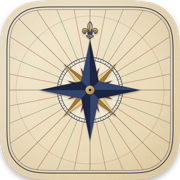
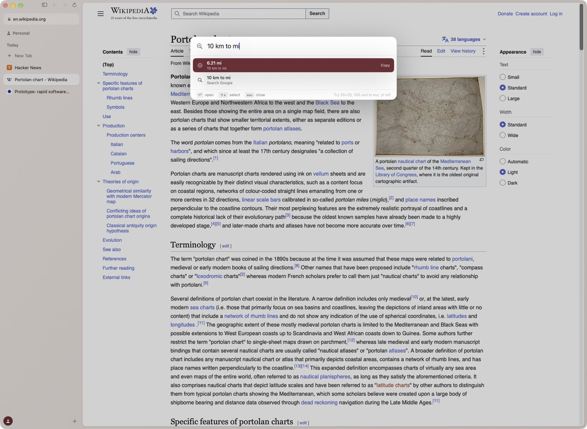

<p align="center">
  
</p>

<h1 align="center">Kaizu</h1>

<p align="center">An Arc-style browser for Mac. Bring your sidebar, keep work and personal logins separate, and browse with WebKit.</p>

<p align="center">
  <a href="CHANGELOG.md"></a>
  
  
</p>

<p align="center">
  <strong><a href="https://kaizu.joinprototype.com/download">Download for Mac</a></strong> ·
  <a href="https://kaizu.joinprototype.com/#open">First launch</a> ·
  <a href="CHANGELOG.md">Changelog</a> ·
  <a href="docs/ROADMAP.md">Roadmap</a>
</p>

<p align="center">
  
</p>

## At home in Kaizu

- **Bring your Arc setup.** Preview your spaces, folders, favorites and tabs before importing them. Your original Arc sidebar stays intact. You can also import bookmarks and history from Chromium browsers or a Safari export.
- **Give each project a space.** Pin the pages you keep coming back to and let Today tabs archive themselves. Use separate profiles when you want separate logins and cookies.
- **Stay on the keyboard.** Press ⌘T to jump to an open tab, find an archived page, run a menu command or convert a measurement. Press ⌘/ to see the shortcuts.
- **Keep your place.** Peek at a link, open it beside the page you’re reading, or split a window into up to four panes. Idle tabs can go to sleep and wake when you return.
- **Control what loads.** Kaizu blocks ads and trackers, rejects supported cookie prompts and strips tracking parameters. Open the site settings in the address bar to pause blocking for one site.

## Install

Download the disk image, open it and drag Kaizu into Applications. The current build is ad-hoc signed and macOS asks for approval on first launch. Once installed, Kaizu checks for signed updates automatically. [First-launch instructions](https://kaizu.joinprototype.com/#open)

Found a bug? Choose **Help → Report a Bug** in Kaizu, or open a [GitHub issue](https://github.com/joinprototype/kaizu/issues). You can also reach the team at [help@joinprototype.com](mailto:help@joinprototype.com).

## Build and test

Use Xcode with the macOS 27 SDK and Swift 6. The app runs on Apple silicon with macOS 15.4 or later.

```sh
swift test                # run the BrowserCore test suite
make run                  # build debug, bundle build/Kaizu.app, launch
make app CONFIG=release   # release bundle
make icon                 # regenerate Resources/AppIcon.icns from scripts/make-icon.swift
```

You can also `open Package.swift` in Xcode and hit Run. The Info.plist is
embedded into the binary, so WebKit gets a bundle identifier either way.

Debug builds accept `KAIZU_DEBUG=commandbar|location|space|settings|history|private|peek|switcher|extension|nosidebar|reader|pin|split|splitdrop|capture|quickbar|open|arcimport` to
boot straight into a UI state (handy for screenshots), and
`KAIZU_SUPPORT=/some/folder` to keep that launch's session and history out
of your real ones. Settings and website data follow the bundle id: for a
copy that can't touch your real browser at all, give its Info.plist another
`CFBundleIdentifier` and re-sign it.

## Release

```sh
scripts/release.sh "$version"  # set version to the release number first
cd site && npx wrangler deploy
```

Add a dated entry to [CHANGELOG.md](CHANGELOG.md) and commit the release metadata. After deploying the site, create a GitHub release tagged `v<version>` at that release commit. Attach the same DMG and update ZIP that went to the site and copy the changelog entry into the release notes.

Build one release at a time with the update signing key. Kaizu reads `version.json` 10
seconds after launch and every 6 hours. A newer build downloads quietly and goes in on restart or
quit, once its Ed25519 signature, bundle id, build number and code signature all check out. If
anything fails, or Kaizu can't replace itself, people get a notice with the download link instead.
It uses Apple frameworks only.

## Docs

- [Roadmap](docs/ROADMAP.md): what's missing vs Arc, phases, motion spec
- [Extension compatibility](docs/ROADMAP.md#password-manager-alternatives) covers the tested Bitwarden build, installation and 1Password alternatives.
- [Architecture](docs/ARCHITECTURE.md): module layout, state model, rules
- [Research](docs/research/): market and Arc analysis

## Data

- App state: `~/Library/Application Support/Kaizu/`
- WebKit profile data: `~/Library/WebKit/com.joinprototype.kaizu/WebsiteDataStore/<profile-uuid>/`

Don't change the bundle ID: WebKit keys profile data (logins) by it.

## License

Kaizu's own code is under the [Mozilla Public License 2.0](LICENSE.md), which
grants no rights to the Kaizu name or logo.

Bundled third-party files keep their own licenses:

- EasyList, EasyPrivacy and the EasyList Cookie List: see [Resources/Filters](Resources/Filters/README.md)
- autoconsent (MPL-2.0) and Readability (Apache-2.0): see [Resources/Scripts](Resources/Scripts/README.md)
- IM Fell, the type on Kaizu's headings (SIL Open Font License): [Resources/Fonts](Resources/Fonts/OFL.txt)
- Site fonts (SIL OFL 1.1): see [site/fonts/OFL.txt](site/fonts/OFL.txt)
