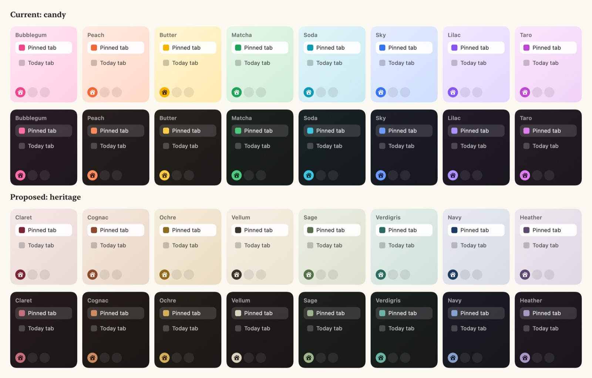

# Heritage palettes (adopted Oct 25)



Eight space colors drawn from the Kaizu icon and old-money interiors:
Claret, Cognac, Ochre, Vellum, Sage, Verdigris, Navy, Heather. Accents are
deep and inky in light mode and softened in dark mode, so the sidebar stays
quiet and the page stays the hero.

Spaces store only a hue and `Theme.forHue` picks the nearest palette, so
switching is a drop-in replacement of `Theme.all` in
`Sources/Kaizu/DesignSystem/Theme.swift`; existing spaces map to the
closest heritage color with no migration:

| Was | Becomes |
|---|---|
| Bubblegum (0.94) | Claret |
| Peach (0.06) | Cognac |
| Butter (0.13) | Ochre |
| Matcha (0.40) | Verdigris |
| Soda (0.52) | Verdigris |
| Sky (0.60) | Navy |
| Lilac (0.72) | Heather |
| Taro (0.84) | Heather |

```swift
extension Theme {
    static let all: [Theme] = [
        Theme(id: "claret", name: "Claret", hue: 0.94,
              light: .init(backdrop: [Color(hex: 0xF3E9E6), Color(hex: 0xE9D9D4)], accent: Color(hex: 0x7A2335), onAccent: Color(hex: 0xF7EEE9)),
              dark: .init(backdrop: [Color(hex: 0x251C1D), Color(hex: 0x1A1516)], accent: Color(hex: 0xC56F7C), onAccent: Color(hex: 0x2A0D13))),
        Theme(id: "cognac", name: "Cognac", hue: 0.05,
              light: .init(backdrop: [Color(hex: 0xF3E8DE), Color(hex: 0xE9D8C7)], accent: Color(hex: 0x8B4A2B), onAccent: Color(hex: 0xFAF1E9)),
              dark: .init(backdrop: [Color(hex: 0x241D18), Color(hex: 0x1A1512)], accent: Color(hex: 0xCB8D61), onAccent: Color(hex: 0x2B160A))),
        Theme(id: "ochre", name: "Ochre", hue: 0.12,
              light: .init(backdrop: [Color(hex: 0xF4ECDA), Color(hex: 0xEADDBF)], accent: Color(hex: 0x8E6B1F), onAccent: Color(hex: 0xFBF5E6)),
              dark: .init(backdrop: [Color(hex: 0x24211A), Color(hex: 0x1A1814)], accent: Color(hex: 0xD4AF5C), onAccent: Color(hex: 0x2B2008))),
        Theme(id: "vellum", name: "Vellum", hue: 0.17,
              light: .init(backdrop: [Color(hex: 0xF5F0E4), Color(hex: 0xEBE3D1)], accent: Color(hex: 0x3B342B), onAccent: Color(hex: 0xF5F0E4)),
              dark: .init(backdrop: [Color(hex: 0x1F1D19), Color(hex: 0x171613)], accent: Color(hex: 0xDCD2BE), onAccent: Color(hex: 0x1F1D19))),
        Theme(id: "sage", name: "Sage", hue: 0.30,
              light: .init(backdrop: [Color(hex: 0xEBEEE2), Color(hex: 0xDCE2CF)], accent: Color(hex: 0x56704A), onAccent: Color(hex: 0xF3F5EC)),
              dark: .init(backdrop: [Color(hex: 0x1E211C), Color(hex: 0x161814)], accent: Color(hex: 0x9DB68E), onAccent: Color(hex: 0x16200F))),
        Theme(id: "verdigris", name: "Verdigris", hue: 0.47,
              light: .init(backdrop: [Color(hex: 0xE4EEEA), Color(hex: 0xD1E2DC)], accent: Color(hex: 0x2C6B5E), onAccent: Color(hex: 0xEEF6F3)),
              dark: .init(backdrop: [Color(hex: 0x1B2220), Color(hex: 0x141917)], accent: Color(hex: 0x6DB4A4), onAccent: Color(hex: 0x0C211C))),
        Theme(id: "navy", name: "Navy", hue: 0.61,
              light: .init(backdrop: [Color(hex: 0xE7EAF0), Color(hex: 0xD6DCE6)], accent: Color(hex: 0x1F3A5F), onAccent: Color(hex: 0xEEF2F8)),
              dark: .init(backdrop: [Color(hex: 0x1A1D24), Color(hex: 0x14161B)], accent: Color(hex: 0x86A2CC), onAccent: Color(hex: 0x0E1A2D))),
        Theme(id: "heather", name: "Heather", hue: 0.77,
              light: .init(backdrop: [Color(hex: 0xEDE8EF), Color(hex: 0xE0D8E4)], accent: Color(hex: 0x5A4870), onAccent: Color(hex: 0xF5F1F7)),
              dark: .init(backdrop: [Color(hex: 0x1F1C23), Color(hex: 0x17151A)], accent: Color(hex: 0xAB97C4), onAccent: Color(hex: 0x1E1529))),
    ]
}
```
